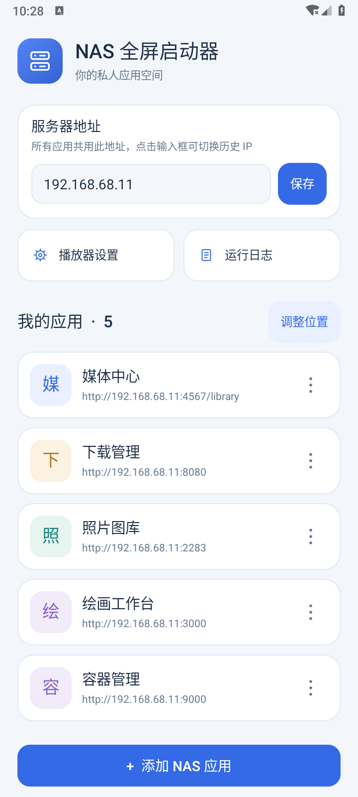
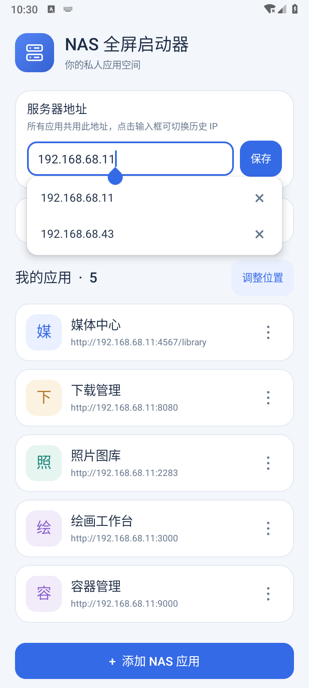
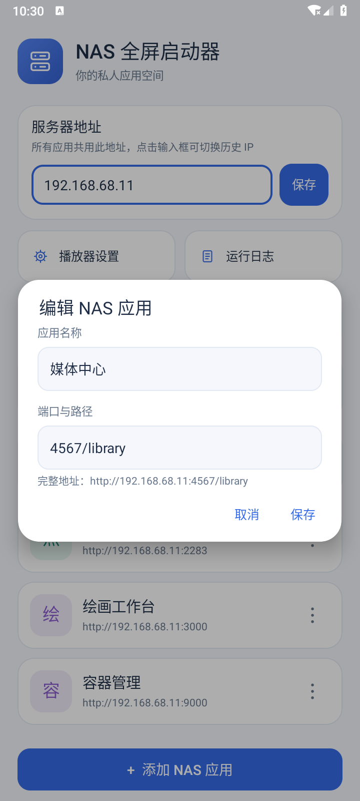
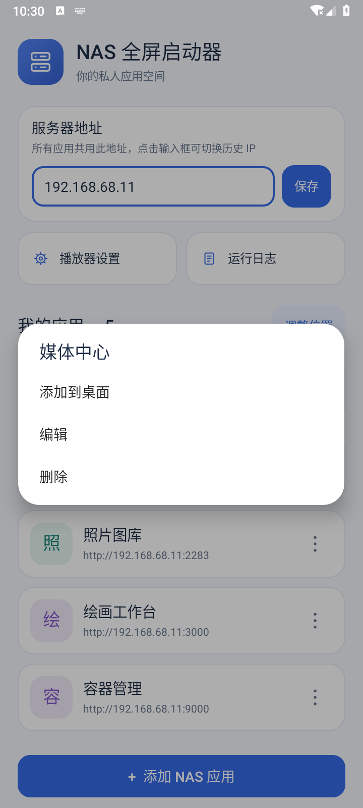
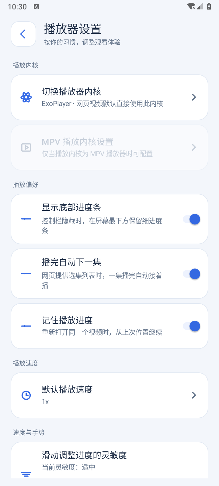
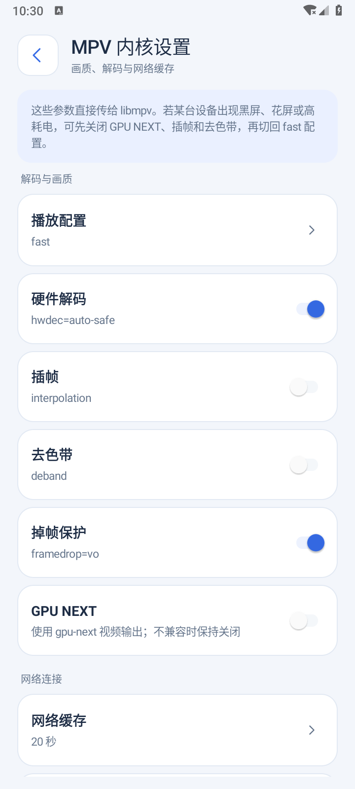
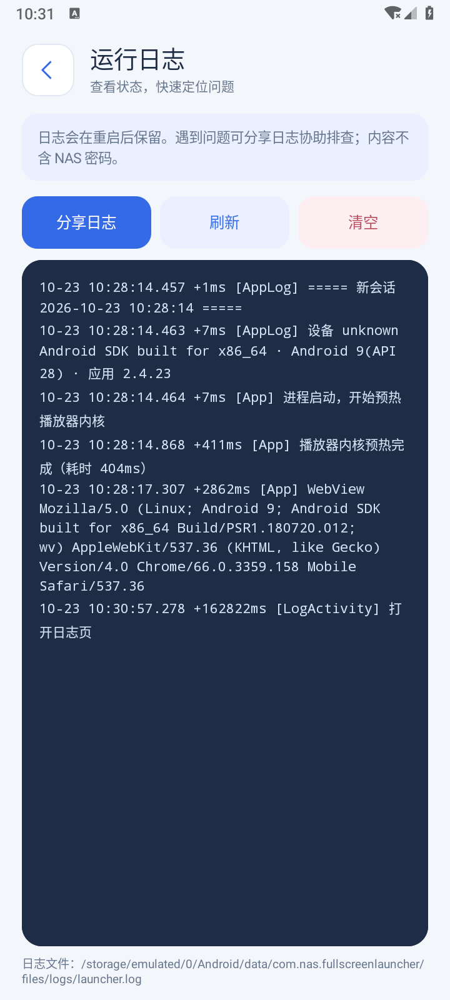

# NAS 全屏启动器

**让 NAS 网页应用，在安卓手机上拥有独立的全屏入口。**

集中管理应用 · 手机文件上传 · 桌面快捷方式 · 内置视频播放器

NAS 全屏启动器是一款面向安卓手机的 NAS 网页应用启动工具。把媒体库、下载器、相册、绘画工具等 Web 服务添加到首页后，轻点卡片即可进入全屏页面，也可以把常用应用添加到手机桌面。

所有应用共用一个服务器地址，各自保存端口和路径。切换 NAS 地址时，无需逐个修改应用配置；网页需要选择手机文件或播放视频时，还可以调用系统文件选择器和内置播放器。

> 文中图片均为应用在安卓模拟器中的实际运行截图，应用名称、IP 和端口使用演示配置。

## 适合哪些场景

- **把 NAS 当作随身应用中心**：集中打开媒体库、下载管理、照片图库、容器管理等网页服务。
- **在手机上使用需要上传文件的工具**：为绘画、图片处理、文档处理等网页选择手机中的文件。
- **为常用服务建立桌面入口**：从手机桌面直接打开指定 NAS 应用。
- **观看 NAS 网页中的视频**：在可识别的视频页面使用内置播放控件、手势和播放偏好。

## 功能介绍

### 共用服务器地址，应用各自保存端口

在首页设置服务器 IP，添加应用时填写名称、端口及可选路径，程序自动组合完整访问地址。

例如：服务器地址为 `192.168.68.11`，应用填写 `4567/library`，访问地址即为 `http://192.168.68.11:4567/library`。

地址输入框提供历史记录，可快速切换曾使用的 IP，也可以删除不再需要的历史项。删除历史记录不会改变当前正在使用的地址。

  
  

### 清晰的应用卡片与管理入口

首页显示应用名称和完整地址，并用柔和的首字标识区分不同应用。

- 轻点卡片进入应用。
- 点击卡片右侧管理按钮，或长按卡片，可编辑、删除应用以及添加桌面快捷方式。
- 点击“调整位置”，通过上移、下移按钮整理应用顺序。
- 列表支持滚动；宽屏且字体大小适合时，应用以双列排列。

桌面快捷方式关联站点 ID，打开时会读取当前服务器地址和站点配置。创建桌面快捷方式需要 Android 8.0 及以上，并由系统桌面确认。

### 独立的全屏页面与任务窗口

每个站点通过独立的网页任务打开，可以在安卓“最近任务”中切换不同应用。同一站点再次打开时，会优先回到对应的任务窗口。

页面由系统 WebView 加载，网页自身负责登录、内容展示和服务端操作。全屏入口适合日常使用，也减少了反复输入地址、寻找浏览器标签的步骤。

### 从手机选择文件并上传

网页中的文件上传按钮可以唤起安卓系统文件选择器，选择手机中的图片、文档或其他文件，再把所选文件交回网页。

- 支持网页声明的文件类型筛选。
- 网页允许多选时，可以选择多个文件。
- 同一页面中的不同上传入口可以分别选择文件。
- 优先调用系统文档选择器，并兼容其他可用的文件选择方式。

是否允许多选、文件大小限制以及上传后的处理流程，仍由对应网页服务决定。

### 内置三种视频播放内核

播放器设置提供 **MediaPlayer、ExoPlayer 和 MpvPlayer** 三种内核，默认使用 ExoPlayer。可以根据设备和视频源情况选择合适的播放内核。

支持的操作包括：

- 单击显示或隐藏控制栏，双击播放或暂停。
- 长按临时切换至 2 倍速，松开后恢复原来的播放速度。
- 横向滑动调整进度；在屏幕左右区域纵向滑动分别调整亮度和音量。
- 上一集、下一集、选集，以及网页提供可识别列表时的自动连播。
- 记住播放进度，再次打开同一视频时继续播放。
- 默认播放速度、进度滑动灵敏度和底部细进度条设置。
- 播放界面锁定、横竖屏切换、视频信息查看与重新加载。
- 网页提供可识别的多个画质源时，切换清晰度。

视频接管、选集、画质切换和自动连播取决于网页提供的信息；可播放的格式和解码能力也取决于所选内核及手机设备。

  
  

选择 MpvPlayer 后，还可以在 MPV 设置中调整播放配置、硬件解码、插帧、去色带、掉帧保护、GPU NEXT、网络缓存和网络超时等参数。

### 持久运行日志

应用提供独立的运行日志页面，便于排查网页打开、播放器加载和文件选择等环节的问题。

日志会持续写入文件，退出或重新打开应用后仍可查看。页面提供刷新、清空和分享日志操作，方便保留问题发生时的记录。

## 安装与快速开始

### 运行条件

- Android 7.0 及以上。
- 当前发布 APK 面向 `arm64-v8a` 设备。
- 手机可以访问目标 NAS 的 IP 和服务端口。
- 系统 WebView 组件可用。

### 添加第一个应用

1. 在仓库的 **Releases** 页面下载 APK，并在安卓手机上安装。
2. 确认手机浏览器能够打开目标 NAS 网页。
3. 打开启动器，在“服务器地址”中填写 NAS 的 IP 并保存，例如 `192.168.68.11`。
4. 点击“添加 NAS 应用”，填写名称，例如“媒体中心”。
5. 填写端口与路径，例如 `4567/library`，核对弹窗中的完整地址并保存。
6. 点击首页卡片进入应用；需要时可将应用添加到手机桌面。

本工具按“共用服务器地址 + 端口/路径”的方式组织入口，常规配置自动组合为 HTTP 地址。NAS 服务部署、端口开放和远程网络连通需要由使用者提前准备。

## 常见问题

### 首页有应用卡片，但网页打不开？

先用手机浏览器访问卡片上的完整地址，确认服务器 IP、服务端口、路径和网络连接正确。启动器提供访问入口，不负责启动 NAS 服务或建立远程网络连接。

### NAS 的 IP 变了，需要重新添加所有应用吗？

在首页保存新的服务器地址，再重新打开应用入口即可。应用原有的端口和路径会继续使用；已经打开的网页可能仍停留在原地址，需要重新进入。

### 为什么网页只允许选择一个文件？

文件选择数量由网页上传控件决定。只有网页声明允许多选时，启动器才会向系统选择器请求多选；如果网页提供两个独立上传入口，请分别选择文件。

### 所有网页视频都可以使用内置播放器吗？

需要网页的视频源能够被识别，并满足对应的访问、鉴权和解码条件。部分网页采用特殊播放器或受保护的视频链路，实际支持情况以具体页面为准。

### 为什么 MPV 设置入口不能点击？

先在“播放器设置”中把内核切换为 **MpvPlayer**，对应的 MPV 设置入口才会启用。

### 应用列表和播放偏好保存在什么地方？

站点配置、IP 历史和播放偏好保存在手机本机的应用数据中。清除应用数据或卸载应用可能导致这些配置丢失。

## 技术组成

应用使用 Android 原生界面和 WebView，并结合 Android MediaPlayer、AndroidX Media3 / ExoPlayer 以及 mpv-android-lib 提供视频播放能力。相关开源组件的版权及许可归属以各项目的授权文件为准。
